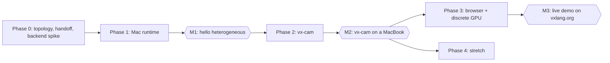

# Proposal: Heterogeneous on a laptop — vx-cam

2026-11-03 · Aditya

## How to file this

File the four **Parent issue** sections as one umbrella issue, then file each numbered sub-issue under it: the heading is the issue title, the text under it is the body. Numbers here are local; set each sub-issue's "blocked by" from the plan table and swap in real issue numbers as you go.

Suggested labels: `laptop-demo`, `phase-0` to `phase-4`, `backend/portable-gpu`, `milestone`.

## Parent issue: summary and motivation

**Title:** Laptop heterogeneous demo: vx-cam, a real-time camera pipeline split across CPU and GPU

Build vx-cam, a real-time camera app (background blur plus auto-framing) whose stages run on a MacBook's CPU and GPU. Each stage's device is chosen in one line and checked by vxc. This is the laptop counterpart to the heterogeneous inference proposal: the same topology types, on a machine anyone can try.

**Why this app**

- It's what browsers already do in every video call: segmentation, blur and compositing, split across CPU and GPU. People recognize it instantly.
- It splits naturally. Dense pixel and convolution work goes to the GPU; branchy per-frame logic (mask smoothing, tracking, framing decisions) goes to the CPU.
- It's visual. You see the result, and an overlay shows which device ran each stage, how long it took and how many bytes moved.
- It can run in a browser tab with nothing to install. WebGPU ships in Chrome, in Safari since Safari 26, and in Firefox on Windows and Apple Silicon Macs.
- Considered and set aside: a local LLM. On Apple silicon the GPU usually wins both prefill and decode, so a CPU/GPU split would look contrived.

**The three demo moments**

1. Moving a stage between CPU and GPU is a one-line change, and the program still type-checks. In the app it's a live toggle.
2. On unified memory, handing a frame from CPU to GPU moves zero bytes. On a discrete GPU, the compiler inserts the copy. Same source; the placement report shows the difference.
3. Touching a frame while another device owns it is a compile error, not a flicker or a race.

Illustrative sketch (pseudocode, not Vx syntax):

```
stage preprocess  @gpu  (Frame)                    -> Tensor
stage segment     @gpu  (Tensor)                   -> Mask
stage smooth      @cpu  (Mask, State)              -> (Mask, CropWindow)   // change to @gpu: one line
stage composite   @gpu  (Frame, Mask, CropWindow)  -> Frame
```

**References**

- [WebGPU vs WebGL for Games (2026)](https://app.cinevva.com/guides/webgpu-vs-webgl-games): Safari 26 shipped WebGPU on macOS
- [WebGL 2 / WebGPU support by platform, Sept 2026](https://app.cinevva.com/de/guides/webgl-webgpu-not-supported-fix): Firefox and Linux Chrome coverage
- [Tint SPIR-V reader overview](https://dawn.googlesource.com/dawn/+show/HEAD/docs/tint/spirv-reader-overview.md): what SPIR-V → WGSL translation can reject
- [spirv-webgpu-transform](https://docs.rs/crate/spirv-webgpu-transform/0.1.5): known gaps in Naga and Tint SPIR-V input

## Parent issue: goals, non-goals, success criteria

This is done when vx-cam runs on a MacBook with every stage switchable between CPU and GPU, and the same source runs from a link in a browser.

**Goals**

- A portable GPU backend that runs on Apple Silicon (Metal) and in the browser (WebGPU)
- Unified memory as a memory space, with typed ownership handoff between CPU and GPU
- A pipeline construct where each stage's device is a one-line choice
- vx-cam on a MacBook, then the same source in a browser tab and on a discrete-GPU machine

**Non-goals**

- The Neural Engine, which is only reachable through Core ML
- Media engines (VideoToolbox): the host shell may use them, but they aren't modeled as devices here
- Matching Apple's or MediaPipe's segmentation quality, or training a model
- iOS
- Peak Metal performance (Phase 4 stretch)

**Success criteria**

- [ ] vx-cam runs at 30 fps or better at 720p on the reference MacBook, with background blur and auto-framing (target)
- [ ] Every stage can run on CPU or GPU, switchable live, and the overlay shows device, time and bytes moved per stage
- [ ] Zero bytes are copied between CPU and GPU stages on unified memory; on a discrete-GPU machine, the placement report shows the copies the compiler inserted
- [ ] Using a buffer another device owns fails to compile, with the example in the docs
- [ ] All compute is Vx; the host shell (input, window, present) stays under about 500 lines (target)
- [ ] The same pipeline runs in Chrome and Safari from a link on vxlang.org

## Parent issue: plan

Phase 0 settles the two decisions everything else rests on: the unified-memory model and the GPU backend path. M1 is a tiny example worth shipping on its own; M2 is the app; M3 is the zero-install link.



| # | Sub-issue | Phase | Blocked by |
| --- | --- | --- | --- |
| 1 | Apple Silicon topology description | 0 | none |
| 2 | Unified memory space and typed buffer handoff | 0 | 1 |
| 3 | Spike: portable GPU backend | 0 | none |
| 4 | Portable GPU backend | 1 | 2, 3 |
| 5 | CPU stages on performance and efficiency cores | 1 | 1 |
| 6 | Pipeline construct with one-line placement | 1 | 2, 4, 5 |
| 7 | M1: hello heterogeneous | 1 | 6 |
| 8 | Host shell: input, window, present | 2 | 6 |
| 9 | Image kernels | 2 | 4, 5 |
| 10 | Segmentation model on GPU | 2 | 4 |
| 11 | CPU stages: mask smoothing and auto-framing | 2 | 5, 6 |
| 12 | Live overlay and placement toggles | 2 | 6, 8 |
| 13 | M2: vx-cam on a MacBook | 2 | 7, 9, 10, 11, 12 |
| 14 | Same source on a discrete-GPU machine | 3 | 13 |
| 15 | Browser build | 3 | 13 |
| 16 | M3: live demo on vxlang.org | 3 | 15 |
| 17 | Native Apple fast paths | 4 | 13 |
| 18 | Frame-budget check | 4 | 13 |

## Parent issue: risks and open questions

The biggest risk is the GPU backend path: one backend has to reach both Metal and WebGPU, and WGSL is a narrow target.

**Risks**

- **Backend path.** SPIR-V → WGSL translators (Naga, Tint) reject some valid SPIR-V, and WGSL lacks features compute code often relies on. #3 settles this with real kernels before anything is built on top.
- **WebGPU limits.** Small default workgroup memory, optional f16 and subgroups, and no zero-copy mapping of storage buffers in the browser. Fine for this demo; performance work moves to native Metal (#17).
- **Browser coverage.** Firefox exposes WebGPU only on Windows and Apple Silicon Macs, and Chrome on Linux only on recent Intel and NVIDIA GPUs. Target Chrome and Safari on a Mac first.
- **Camera friction.** Start from a video file; the camera is a host-shell detail added later.
- **Model license and size.** The segmentation model must allow redistribution and be small enough for WebGPU.
- **Polish creep.** The UI stays minimal: video, overlay, toggles.
- **Overlap with the heterogeneous inference proposal.** Cluster topology types there and the unified memory space here need one design, not two.

**Open questions**

- [ ] Backend path: decided in #3
- [ ] Host shell: Rust (winit + wgpu) or Swift (AVFoundation + MetalKit)? Rust shares more with the Linux and browser builds; Swift is the most native camera path.
- [ ] Segmentation model: which one, under what license?
- [ ] Live placement switching: compile every allowed device variant up front, or recompile on toggle?
- [ ] Reference MacBook chip (M1 to M4)? It sets the fps target and whether SME is in scope.
- [ ] Where does vx-cam live: `vx-lang/Vx` examples or its own repo?

---

## Sub-issues, Phase 0: foundations

### 1. Apple Silicon topology description

Describe a MacBook as a Vx topology: two CPU clusters and a GPU sharing one unified memory.

- [ ] Device kinds: performance-core cluster, efficiency-core cluster, Apple GPU (family reported by Metal)
- [ ] One unified memory space shared by all three, with capacity and bandwidth
- [ ] Runtime discovery (`sysctl hw.perflevel*` for core counts; the Metal device for GPU family and recommended working-set size) checked against the compile-time spec
- [ ] Spec files for the reference MacBook and for a Linux machine with a discrete GPU

**Done when:** both specs type-check, and vxc prints the discovered topology on the MacBook.

**Blocked by:** none

### 2. Unified memory space and typed buffer handoff

A buffer belongs to one device at a time, and the topology decides what a handoff costs.

- [ ] Handing a buffer to another device is a typed move
- [ ] On unified memory the move lowers to a synchronization point only; on discrete memory it lowers to a copy
- [ ] Using a buffer after handing it off is a compile error
- [ ] Placement report listing every handoff and whether it copied

**Done when:** a two-stage CPU → GPU program compiles for both specs from #1, the report shows 0 bytes copied on the MacBook and one copy on the discrete-GPU spec, and a use-after-handoff test fails to compile.

**Blocked by:** #1

### 3. Spike: portable GPU backend

Pick the path that gets Vx kernels onto Metal and WebGPU from one backend.

Options:

- **A. SPIR-V, then Naga.** MLIR's SPIR-V dialect → SPIR-V → Naga (Rust, already in the wgpu stack) → WGSL for the browser, MSL via wgpu on the Mac. This is the same SPIR-V a Vulkan backend needs.
- **B. Direct WGSL emitter** from Vx's kernel IR → wgpu natively and WebGPU in the browser. Avoids SPIR-V reader gaps, but Vulkan doesn't come for free.
- **C. Direct MSL emitter.** Fastest on the Mac, but no browser.

Tasks:

- [ ] Port two reference kernels (separable blur, tiled GEMM) through A and B
- [ ] Record what each translator rejected, the workarounds, and time per frame on the MacBook natively and in Chrome
- [ ] Commit a decision record to the repo

**Done when:** the decision is recorded with the numbers behind it.

**Blocked by:** none

---

## Sub-issues, Phase 1: Mac runtime

### 4. Portable GPU backend

Implement the path chosen in #3, end to end.

- [ ] Kernel lowering per the decision record, with WGSL limits (workgroup memory, optional f16, no recursion) checked at compile time with readable errors
- [ ] GPU runtime on wgpu: device, buffers, bind groups, dispatch, timestamps
- [ ] Buffer handoff from #2 lowered onto the runtime (map and unmap on unified memory, copy otherwise)
- [ ] Test suite runs on the MacBook through Metal

**Done when:** the reference kernels from #3 pass their tests on the MacBook.

**Blocked by:** #2, #3

### 5. CPU stages on performance and efficiency cores

Run CPU stages on the right core cluster.

- [ ] Thread pool for CPU stages
- [ ] Placement on performance or efficiency cores mapped to macOS QoS classes (macOS steers threads by QoS rather than allowing core pinning)
- [ ] NEON vectorization confirmed on the hot loops of the reference CPU kernels

**Done when:** a CPU stage placed on efficiency cores runs there in Instruments, and the same stage on performance cores is faster.

**Blocked by:** #1

### 6. Pipeline construct with one-line placement

The construct the whole demo rests on: stages, a device per stage, and the handoffs between them.

- [ ] Stages with typed inputs, typed outputs and a device annotation
- [ ] Each stage compiled for every device it's allowed on, so placement can switch at run time (see open questions)
- [ ] Frame ring (double or triple buffering) so CPU and GPU stages overlap
- [ ] Per-stage telemetry: device, time, bytes moved

**Done when:** changing one stage's device is a one-line edit or a live toggle, and the program still type-checks.

**Blocked by:** #2, #4, #5

### 7. M1: hello heterogeneous

The smallest end-to-end example, shipped in `examples/`.

- [ ] Image in → GPU blur → CPU histogram → GPU tone-map → image out
- [ ] Run with each stage on CPU and on GPU, and print the telemetry table
- [ ] Short README walking through the placement report

**Done when:** it runs on the MacBook from a fresh clone with one command.

**Blocked by:** #6

---

## Sub-issues, Phase 2: vx-cam

### 8. Host shell: input, window, present

Keep everything that isn't compute out of Vx, and keep it small.

- [ ] Video-file input first, camera second
- [ ] Window and present; frames enter the pipeline as owned buffers (#2)
- [ ] C ABI boundary into the Vx-compiled pipeline

**Done when:** a video file plays through a pass-through pipeline at its source frame rate, and the shell is under about 500 lines.

**Blocked by:** #6

### 9. Image kernels

The pixel work, written once in Vx for both devices.

- [ ] Color conversion and resize to the model's input
- [ ] Separable Gaussian blur
- [ ] Mask upsampling with an edge-aware (guided) filter
- [ ] Composite, crop and zoom for auto-framing
- [ ] CPU (NEON) and GPU versions of each, checked against each other

**Done when:** every kernel passes its tests on both devices.

**Blocked by:** #4, #5

### 10. Segmentation model on GPU

The inference stage of the pipeline.

- [ ] Choose the model (see open questions) and write a weight loader
- [ ] Kernels: convolution, depthwise convolution, activations, upsample
- [ ] Output checked against the model's reference implementation

**Done when:** masks match the reference within tolerance on a fixed clip, within the frame budget on the MacBook.

**Blocked by:** #4

### 11. CPU stages: mask smoothing and auto-framing

The branchy, stateful work that belongs on the CPU.

- [ ] Temporal smoothing of the mask across frames
- [ ] Person bounding box from the mask, smoothed into a stable crop window
- [ ] CPU by default, with a GPU variant so the toggle works

**Done when:** the crop window follows a person without jitter on the test clip.

**Blocked by:** #5, #6

### 12. Live overlay and placement toggles

What makes the demo legible in 10 seconds.

- [ ] Overlay per stage: device, time, bytes moved, plus total frame time against the budget
- [ ] Keyboard toggles move a stage between CPU and GPU live
- [ ] The overlay updates within a second of a toggle

**Done when:** every stage can be toggled without a restart.

**Blocked by:** #6, #8

### 13. M2: vx-cam on a MacBook

The app, measured and shown.

- [ ] Background blur and auto-framing at 720p, 30 fps or better on the reference MacBook (target)
- [ ] 60-second demo video: toggles, overlay, zero bytes moved
- [ ] README: build, run, what to look at

**Done when:** published with the measured numbers, whatever they are.

**Blocked by:** #7, #9, #10, #11, #12

---

## Sub-issues, Phase 3: browser and discrete GPU

### 14. Same source on a discrete-GPU machine

Show that the topology, not the source, decides where copies happen.

- [ ] Build vx-cam for the Linux + discrete GPU spec from #1, through the portable backend (Vulkan via wgpu)
- [ ] Placement report shows the copies the compiler inserted, and the overlay shows their cost
- [ ] No source changes between the Mac and Linux builds

**Done when:** it runs on Linux with an NVIDIA or AMD GPU, and the side-by-side placement reports are in the README.

**Blocked by:** #13

### 15. Browser build

The same pipeline in a browser tab.

- [ ] CPU stages to WebAssembly with SIMD and threads; threads need cross-origin isolation (COOP/COEP headers)
- [ ] WebAssembly target added to the bundled LLVM, checked against the build-time constraint in vx-lang/Vx#1269
- [ ] GPU stages to WebGPU; camera frames enter through `importExternalTexture`
- [ ] Thin JS shell in place of the native host shell

**Done when:** vx-cam runs in Chrome and in Safari 26+ on the MacBook, served locally.

**Blocked by:** #13

### 16. M3: live demo on vxlang.org

The zero-install link.

- [ ] Host the browser build on vxlang.org with COOP/COEP headers
- [ ] Clear fallback message when WebGPU isn't available
- [ ] Link from the README and the site's front page

**Done when:** a visitor on an Apple Silicon Mac opens the link and sees vx-cam running on their own CPU and GPU.

**Blocked by:** #15

---

## Sub-issues, Phase 4: stretch

### 17. Native Apple fast paths

Go past what the portable path allows, on both sides of the chip.

- [ ] Native Metal path: shared-storage buffers for true zero-copy, simdgroup matrix operations for convolution
- [ ] SME/SME2 for CPU matrix work on M4-class chips, through LLVM
- [ ] Comparison against the portable path on the same frames

**Done when:** the comparison is published and the faster path is selectable per stage.

**Blocked by:** #13

### 18. Frame-budget check

Extend admission from "does it fit in memory" to "does it make the frame rate on this machine".

- [ ] Calibrate per-stage costs on each device in one run, stored per machine spec
- [ ] `vxc check --frame-budget 33ms` rejects placements that can't make 30 fps, naming the stage that breaks the budget
- [ ] Verdicts compared against measured frame times

Unlike memory admission, this depends on calibrated timings rather than static analysis alone; the docs should say so.

**Done when:** the verdict matches measurement on the MacBook for the default placement and two deliberately bad ones.

**Blocked by:** #13
